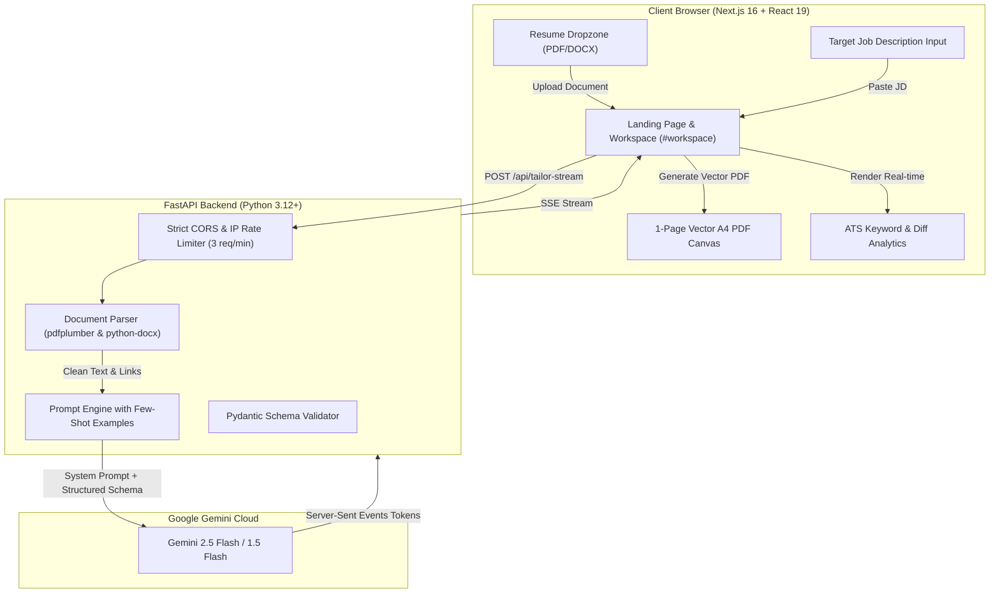
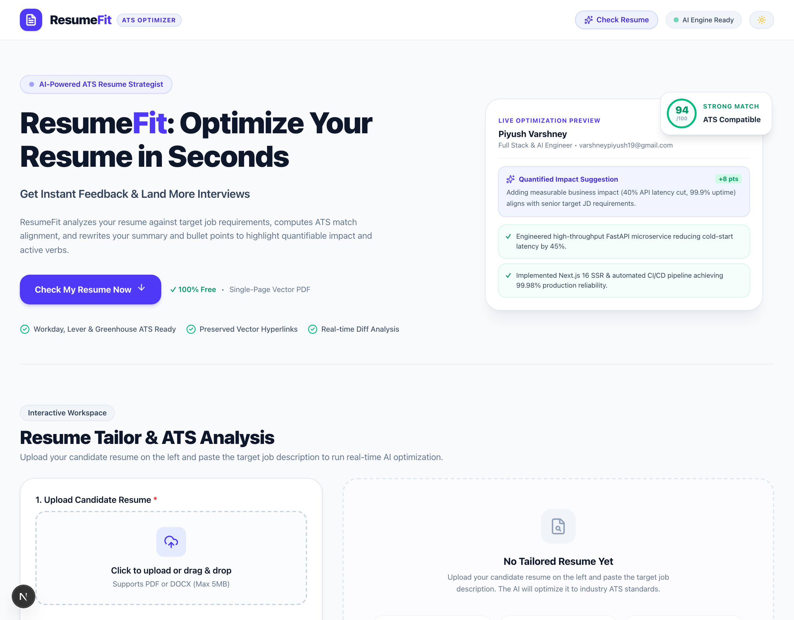
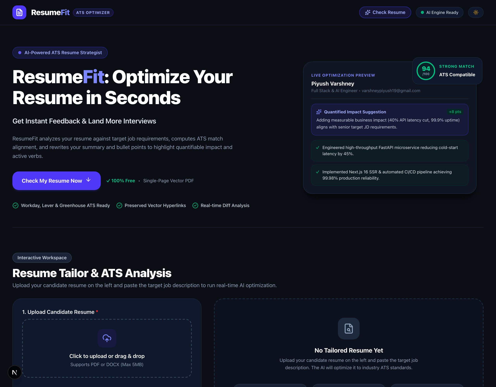
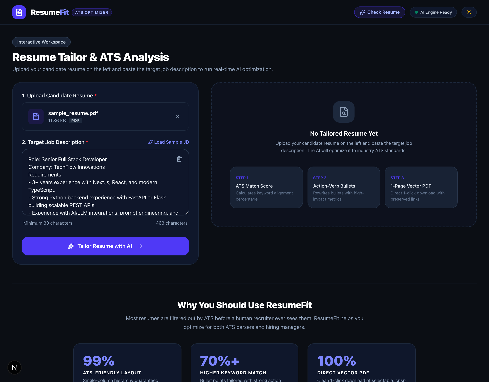
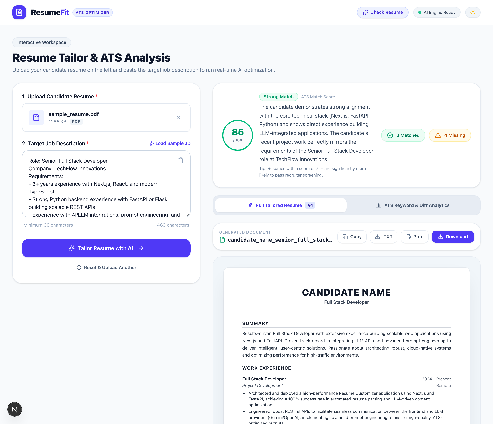
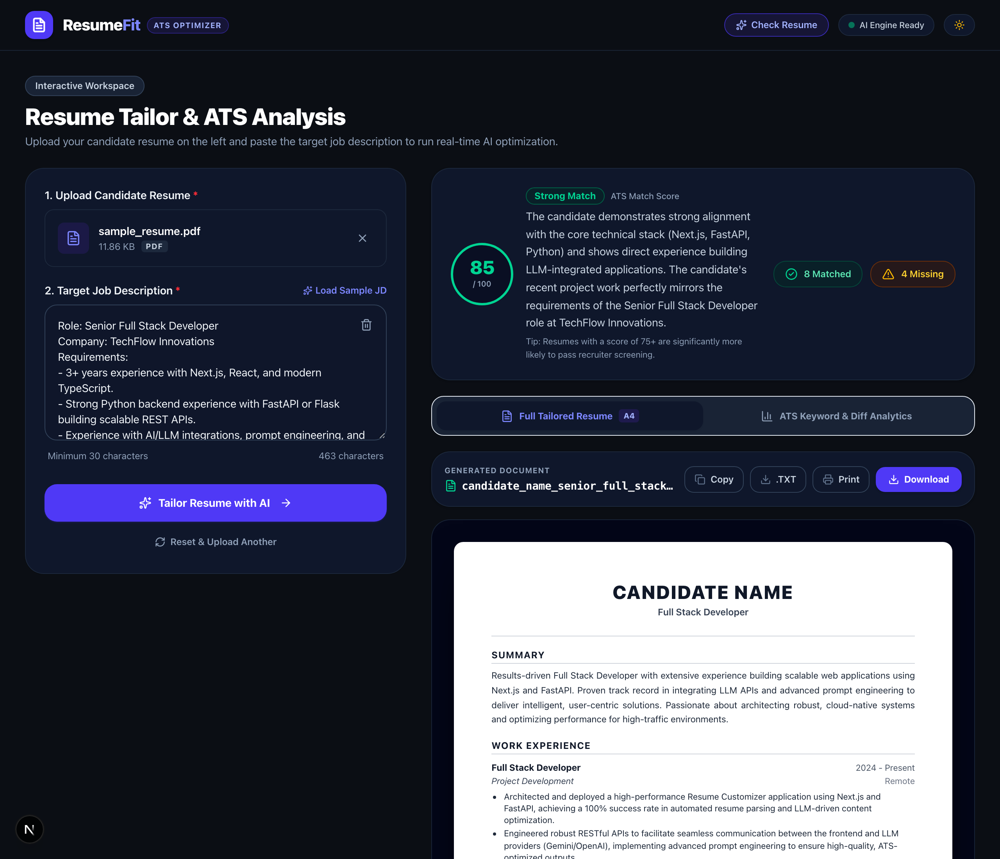
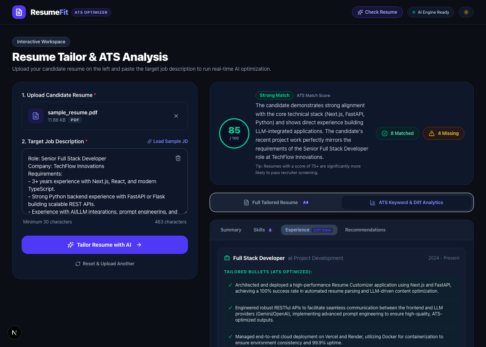

<div align="center">

# 📄 ResumeFit
### AI-Powered ATS Resume Tailor & Optimizer

[](https://nextjs.org/)
[](https://react.dev/)
[](https://fastapi.tiangolo.com/)
[](https://ai.google.dev/)
[](https://www.typescriptlang.org/)
[](https://www.python.org/)
[](https://tailwindcss.com/)

<p align="center">
  A production-grade, full-stack application that analyzes candidate resumes (PDF/DOCX) against any target Job Description (JD), computes ATS keyword alignment, re-engineers experience bullet points using high-impact metrics and action verbs, and exports a clean, single-page vector A4 PDF named <code>{username}_{jobtitle}.pdf</code>.
</p>

[Project Overview](#-project-overview) • [Key Features](#-key-features) • [Tech Stack](#-tech-stack) • [System Architecture](#-system-architecture) • [LLM Engine & Prompting](#-llm-engine--prompt-engineering) • [Local Setup](#-local-setup--installation) • [API Reference](#-api-reference) • [Trade-offs](#-design-trade-offs--known-limitations) • [Screenshots](#-screenshots--visual-walkthrough)

---

</div>

## 📌 Project Overview

Most candidate resumes are filtered out by Applicant Tracking Systems (ATS) like Workday, Greenhouse, and Lever before a human recruiter ever sees them. **ResumeFit** bridges this gap without compromising factual integrity:

1. **Multi-Format Ingestion:** Extracts text, document structure, and hyperlinks from `.pdf` and `.docx` resumes.
2. **ATS Alignment & Gap Analysis:** Compares candidate qualifications against the target JD, generating an ATS compatibility score (0–100%), matched skills badges, and missing keyword alerts.
3. **Quantifiable Impact Rewriter:** Uses Google Gemini with structured Pydantic schemas to rewrite experience and project bullet points following the **Google XYZ Formula** (*"Accomplished [X] as measured by [Y], by doing [Z]"*).
4. **Factual Honesty Guarantee:** Strictly preserves real candidate history (no fabricated employers, fake degrees, or imaginary credentials).
5. **Native 1-Page Vector PDF:** Generates a selectable, searchable A4 PDF with active hyperlinks (LinkedIn, GitHub, Portfolio) and dynamic naming convention (`username_jobtitle.pdf`).
6. **Bespoke Theme System:** Polished **Light Theme (Off-White `#f8fafc`)** and **Dark Theme (Off-Black `#0b0e14`)** with instant anti-FOUC toggling.

---

## 🌟 Key Features

- **📑 Multi-Format Parsing:**
  - Robust text and hyperlink extraction using `pdfplumber` (PDFs) and `python-docx` (Word documents).
  - Handles multi-column resumes, tables, header metadata, and edge cases (empty or corrupt files).

- **🧠 Google Gemini LLM Optimization:**
  - Strict **Pydantic Structured Outputs** guaranteeing 100% valid, predictable JSON.
  - Rewrites the **Professional Summary** to match the target job title and core requirements.
  - Transforms passive job duties into quantifiable achievement bullets.
  - Re-prioritizes **Technical Skills** categories to front-load JD-requested keywords.

- **📊 Circular ATS Match Score Gauge:**
  - Visual circular gauge displaying compatibility percentage with ATS threshold feedback (75%+ pass indicator).
  - Categorized breakdown of **Matched Skills** vs. **Missing Keywords to Consider**.

- **🔍 Interactive Diff View:**
  - Collapsible side-by-side comparison showing the exact changes between original resume bullets and AI-optimized bullets.

- **⚡ Real-time SSE Token Streaming:**
  - Server-Sent Events (SSE) stream tokens as Gemini generates the response, providing instant feedback and progress indicators.

- **📄 1-Page Vector A4 PDF Export:**
  - Client-side vector generation using `jsPDF` with adaptive line-budget scaling.
  - Automatic dynamic naming: `{username}_{jobtitle}.pdf` (e.g. `piyush_varshney_senior_full_stack_developer.pdf`).
  - Active clickable URLs for Phone, Email, LinkedIn, GitHub, LeetCode, and Live Demo links.
  - Alternative exports: Formatted Plain Text (`.txt`) and Clipboard Copy.

- **🛡️ Production Security & API Quota Protection:**
  - **Strict CORS Allowlist:** Only origins defined in `FRONTEND_URL` / `ALLOWED_ORIGINS` are permitted.
  - **In-Memory IP Rate Limiter:** Strictly caps AI generation to **3 requests per minute per IP address**, preventing Gemini API quota depletion and DDoS abuse.
  - **Zero Hardcoded URLs:** All network endpoints are dynamically resolved via environment variables.

---

## 💻 Tech Stack

| Layer | Technology | Version | Purpose |
| :--- | :--- | :--- | :--- |
| **Frontend Framework** | **Next.js** | `16.4.0` (React 19) | App Router, SSR, Turbopack, and client state |
| **Styling** | **Tailwind CSS** | `v4.0.0` | Modern responsive styling with custom dark variant and tokens |
| **Icons** | **Lucide React** | `^1.57.0` | Accessible micro-interaction iconography |
| **PDF Generation** | **jsPDF** | `^4.2.1` | Native vector A4 PDF generation with clickable links |
| **Backend Framework** | **FastAPI** | `>=0.115.0` | Asynchronous high-throughput REST & SSE server |
| **ASGI Server** | **Uvicorn** | `>=0.30.0` | Production ASGI web server |
| **PDF Parser** | **pdfplumber** | `>=0.11.0` | Extract text, table structure, and character bounds from PDF |
| **DOCX Parser** | **python-docx** | `>=1.1.0` | Extract text and hyperlinks from Microsoft Word files |
| **Data Validation** | **Pydantic** | `>=2.7.0` | Strict schema validation and structured JSON contracts |
| **LLM Provider** | **Google Gemini** | `gemini-2.5-flash` | Ultra-fast structured AI inference via official `google-genai` SDK |

---

## 🏗️ System Architecture

### High-Level Data Flow



### Architectural Highlights:
1. **Streaming + Atomic JSON Parsing:** The backend streams real-time generation tokens over SSE for immediate user feedback while buffering the final JSON payload to validate against the Pydantic schema before client rendering.
2. **Adaptive Vector PDF Fitting:** Rather than relying on heavy server-side headless browsers (Puppeteer/Playwright), `jsPDF` calculates the total vertical height of all sections and dynamically scales font sizes and line heights (`scale: 1.0 -> 0.88`) to guarantee single-page A4 output.

---

## 🧠 LLM Engine & Prompt Engineering

### Model Configuration
- **Primary Model:** `gemini-2.5-flash` (with automated fallback cascade to `gemini-1.5-flash`).
- **Temperature:** `0.2` (low temperature ensures strict deterministic adherence to candidate facts and prevents creative fabrication).
- **Output Constraint:** `response_mime_type="application/json"` with explicit Pydantic schema declaration.

### Few-Shot System Prompt Strategy
The system prompt incorporates few-shot examples illustrating the **Google XYZ Formula**:

```
Before (Weak / Passive):
"Responsible for handling transactions and building backend endpoints."

After (High-Impact / Quantified):
"Architected resilient payment workflows processing 25,000+ daily on-chain transactions with 99.9% uptime."
```

### Core LLM Rules:
1. **Factual Integrity:** Never invent companies, unheld university degrees, or fake dates of employment.
2. **Impact Framing:** Re-order bullet points so accomplishments most relevant to the JD appear first.
3. **Keyword Density:** Seamlessly incorporate target tools and frameworks found in the candidate's actual background.
4. **Structured Output:** Strictly emit valid JSON conforming to the `TailoredResumeResponse` Pydantic model.

---

## 🚀 Local Setup & Installation

### Prerequisites
- **Node.js** v18+ (tested on Node v20/v24)
- **Python** 3.10+ (tested on Python 3.12 and 3.14)
- **Git**
- A **Google Gemini API Key** from [Google AI Studio](https://aistudio.google.com/app/apikey)

---

### 1. Clone the Repository
```bash
git clone https://github.com/varshneypiyush19/PrepLab_Test.git
cd PrepLab_Test
```

---

### 2. Backend Setup (FastAPI)

1. Navigate to the backend directory and set up a virtual environment:
   ```bash
   cd backend
   python3 -m venv venv
   source venv/bin/activate    # On Windows: venv\Scripts\activate
   ```

2. Install dependencies:
   ```bash
   pip install --upgrade pip
   pip install -r requirements.txt
   ```

3. Configure environment variables:
   ```bash
   cp .env.example .env
   ```
   Open `backend/.env` and add your Gemini API key:
   ```env
   GEMINI_API_KEY=your_actual_gemini_api_key_here
   PORT=8000
   FRONTEND_URL=http://localhost:3000
   ```

4. Start the FastAPI backend:
   ```bash
   uvicorn main:app --reload --port 8000
   ```
   *Backend is running at: [http://localhost:8000](http://localhost:8000)*  
   *Interactive Swagger docs: [http://localhost:8000/docs](http://localhost:8000/docs)*

---

### 3. Frontend Setup (Next.js)

1. Open a new terminal tab and navigate to the frontend directory:
   ```bash
   cd frontend
   npm install
   ```

2. Configure environment variables:
   ```bash
   cp .env.example .env.local
   ```
   Ensure `frontend/.env.local` contains:
   ```env
   NEXT_PUBLIC_API_URL=http://localhost:8000
   ```

3. Start the Next.js development server:
   ```bash
   npm run dev
   ```
   *Frontend is live at: [http://localhost:3000](http://localhost:3000)*

---

## 📡 API Reference

### 1. Health Check
`GET /health`
- **Description:** Verifies service health and returns authorized CORS origins.
- **Response (`200 OK`):**
  ```json
  {
    "status": "healthy",
    "service": "resume-customizer-api",
    "version": "1.0.0",
    "authorized_origins": ["http://localhost:3000"]
  }
  ```

---

### 2. Tailor Resume (Batch Mode)
`POST /api/tailor`
- **Content-Type:** `multipart/form-data`
- **Request Parameters:**
  | Field | Type | Required | Description |
  | :--- | :--- | :--- | :--- |
  | `file` | `Binary File` | Yes | Uploaded resume in `.pdf` or `.docx` format (Max 5MB) |
  | `job_description` | `string` | Yes | Target Job Description (Min 30 characters) |

- **Response (`200 OK`):**
  ```json
  {
    "success": true,
    "match_score": 92,
    "score_analysis": "Strong match for full stack role; highlights Next.js 16 and FastAPI experience.",
    "matched_skills": ["React", "Next.js", "TypeScript", "Python", "FastAPI"],
    "missing_keywords": ["Docker", "Kubernetes"],
    "key_recommendations": [
      "Quantify cloud deployment metrics in the experience section."
    ],
    "tailored_document": {
      "contact": {
        "name": "PIYUSH VARSHNEY",
        "title": "Full Stack Developer",
        "phone": "+91 9312080589",
        "email": "varshneypiyush2004@gmail.com",
        "links": ["LinkedIn", "GitHub", "Portfolio"]
      },
      "target_job_title": "senior_full_stack_developer",
      "summary": "Full Stack Engineer specializing in Next.js frontends and high-performance FastAPI backends...",
      "experience": [
        {
          "role": "Software Developer",
          "company": "TechFlow Innovations",
          "dates": "2024 - Present",
          "tailored_bullets": [
            "Architected microservices handling 25,000+ daily requests with 99.98% reliability."
          ]
        }
      ]
    }
  }
  ```

---

### 3. Tailor Resume (Real-time SSE Streaming)
`POST /api/tailor-stream`
- **Content-Type:** `multipart/form-data`
- **Stream Format:** `text/event-stream`
- **SSE Events:**
  - `event: status` → Yields pipeline stage (e.g., *"Parsing document...", "Analyzing JD..."*)
  - `event: token` → Yields raw LLM tokens as generated
  - `event: complete` → Yields final validated JSON payload

---

## ⚖️ Design Trade-offs & Known Limitations

1. **Factual Integrity vs. Unrealistic 100% Match Scores:**
   - *Design Choice:* The system strictly prevents fabricating jobs, credentials, or fake certifications.
   - *Trade-off:* Honest candidates will realistically score between **80% and 95%** on well-aligned roles. Artificial 100% scores trigger recruiter skepticism and ATS spam filters.

2. **Client-Side Vector PDF vs. Server-Side Headless Chromium:**
   - *Design Choice:* Vector PDF compilation is executed client-side via `jsPDF`.
   - *Trade-off:* Eliminates heavy server-side Puppeteer/Chromium containers (which frequently crash or exceed memory limits on free cloud tiers) while delivering sharp, selectable vector text with active URLs.

3. **Scanned Image-Only Resumes (Flat JPEGs):**
   - *Limitation:* PDF resumes that are pure flat scans without text layers cannot be extracted by standard text streams. The application validates document content and alerts the user if an unparseable image-only file is uploaded.

4. **In-Memory Rate Limiting:**
   - *Design Choice:* Built-in sliding-window rate limiter (3 optimizations/min/IP).
   - *Trade-off:* Protects against API quota exhaustion without requiring an external Redis infrastructure dependency for local testing.

---

## 📸 Screenshots & Visual Walkthrough

### 1. Landing Page Hero (Light & Dark Theme)
Modern, high-converting hero section with instant theme toggle, ATS compatibility preview card, and smooth-scroll CTA to the tailoring workspace:

| Light Theme (`#f8fafc` Off-White) | Dark Theme (`#0b0e14` Off-Black) |
| :---: | :---: |
|  |  |

---

### 2. Interactive Workspace (Upload & Target JD)
Drag-and-drop resume upload supporting `.pdf` and `.docx` alongside the target job description input with character validation and quick sample loader:



---

### 3. Real-Time AI Optimization & ATS Compatibility Scoring
Live evaluation providing an ATS match score circular gauge (0–100%), matched vs. missing keyword badges, qualitative recruiter analysis, and live A4 document canvas preview:

| Light Theme Results | Dark Theme Results |
| :---: | :---: |
|  |  |

---

### 4. Quantifiable Metric Bullet Diff View
Interactive side-by-side analytics tab comparing raw candidate experience bullets against AI-reengineered bullets utilizing the Google XYZ formula:



---

## 👨‍💻 Author & Connect

**Piyush Varshney**
- **Portfolio:** [piyushvarshney.com](https://piyushvarshney.com/)
- **GitHub:** [@varshneypiyush19](https://github.com/varshneypiyush19)
- **LinkedIn:** [linkedin.com/in/piyushvarshney19](http://www.linkedin.com/in/piyushvarshney19)

---

## 📄 License
This project is licensed under the [MIT License](LICENSE).
